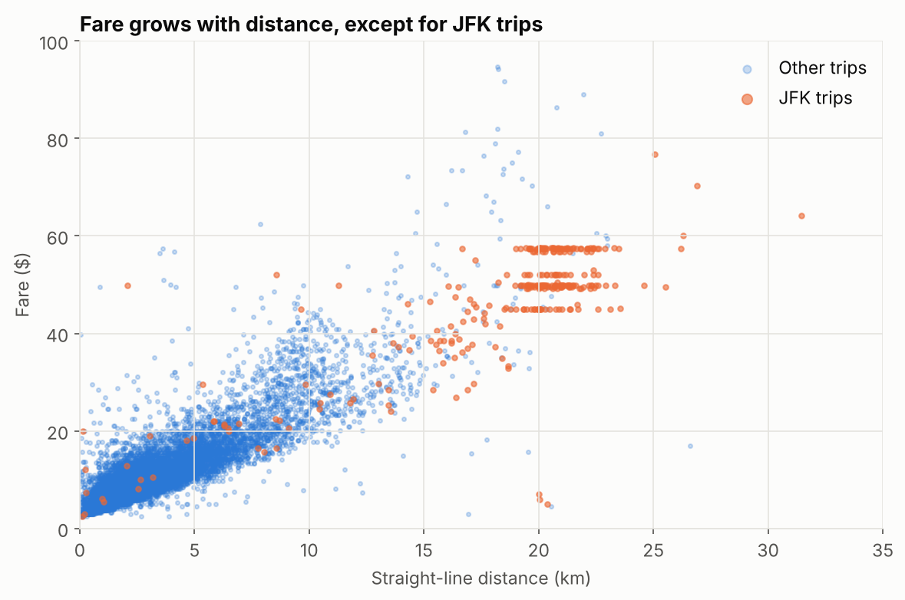
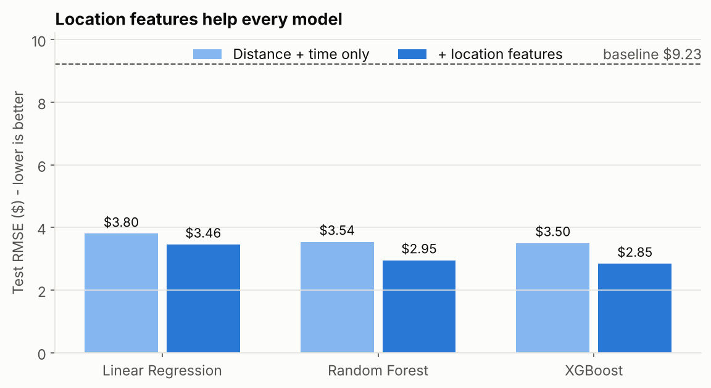
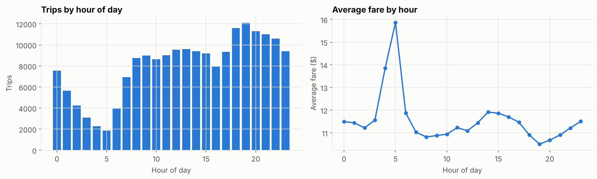
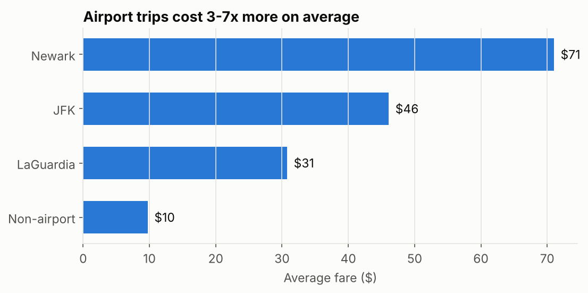
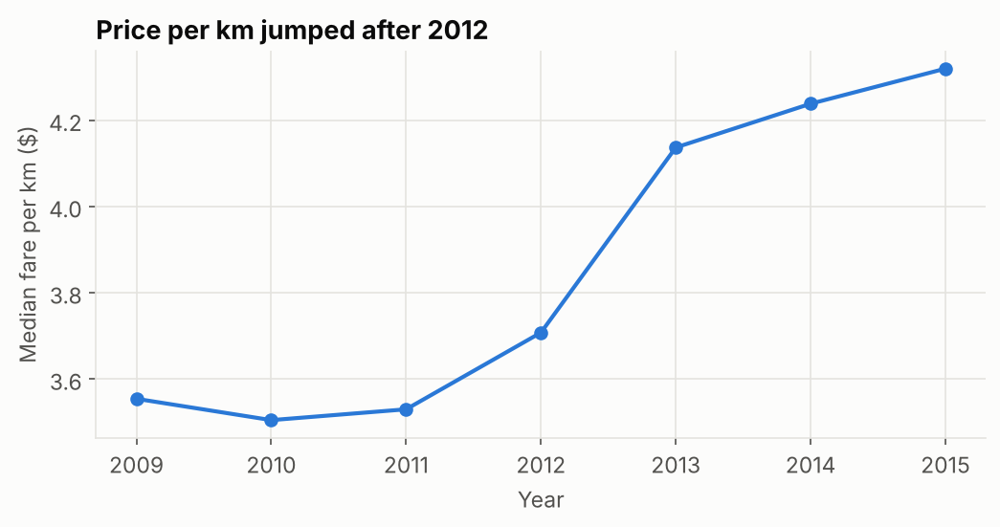
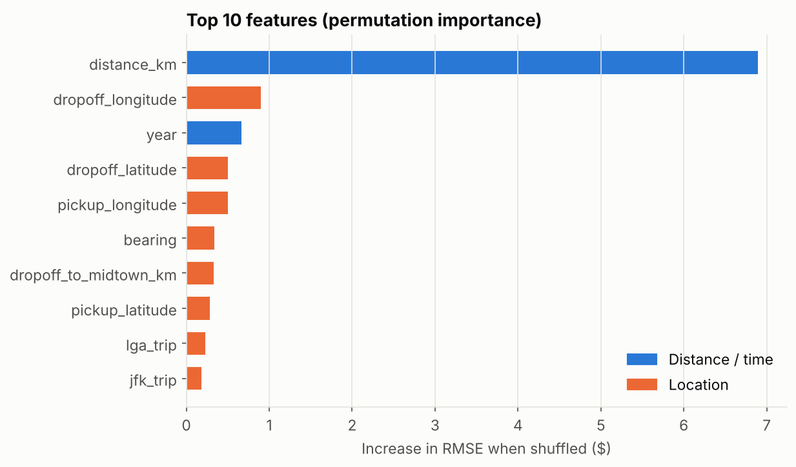
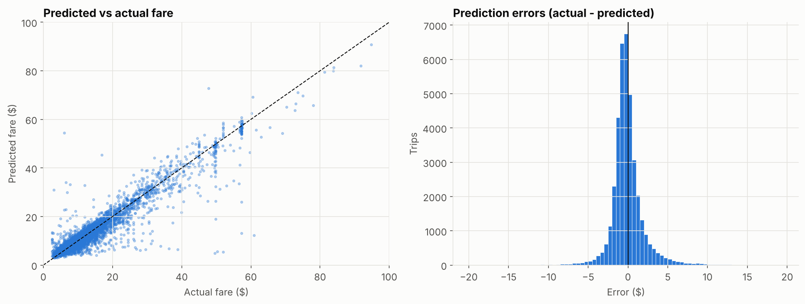

# Uber Fare Prediction (NYC)


Predicting the fare of an Uber ride in New York City from pickup/dropoff location, time and passenger count. That's basically the information you have when someone books a ride.

The final XGBoost model predicts fares with an **RMSE of $2.83** and an **R² of 0.91** on held-out trips. Half of its predictions are within **$0.88** of the actual fare.



## The short version

I started with the usual approach for this dataset: distance + time features and a few models. That got an RMSE of about $3.50. Most of the improvement after that **didn't come from the model**. It came from:

1. **Cleaning the data properly.** The raw data has negative fares, a $499 fare, a trip with 208 passengers, and pickups at (0, 0) off the coast of Africa.
2. **Adding location features.** The chart above shows why. Most trips follow a line where fare goes up with distance, but JFK trips form flat bands at $45-$57 because they had a fixed fare to Manhattan. Distance alone can't explain that.

## Results

All numbers are on the same 20% test set (38,403 trips).

| Model | Features | RMSE ($) | MAE ($) | R² |
|---|---|---|---|---|
| Baseline (always predict the mean) | - | 9.23 | 5.87 | 0.00 |
| Linear Regression | distance + time | 3.80 | 2.14 | 0.830 |
| Linear Regression | + location | 3.46 | 1.96 | 0.860 |
| Random Forest | distance + time | 3.54 | 1.97 | 0.852 |
| Random Forest | + location | 2.95 | 1.57 | 0.897 |
| XGBoost | distance + time | 3.50 | 1.91 | 0.856 |
| XGBoost | + location | 2.85 | 1.47 | 0.905 |
| **XGBoost (tuned)** | **+ location** | **2.83** | **1.46** | **0.906** |



Adding the location features cut XGBoost's error by almost 20%. Hyperparameter tuning only shaved off another cent or two, which says a lot about where the effort should go.

## What I did

**1. Cleaning** (removed 4% of rows)

| Rule | Rows removed |
|---|---|
| Fare outside $2.50 - $200 | 32 |
| Passenger count not between 1 and 6 | 709 |
| Pickup or dropoff outside NYC | 4,387 |
| Pickup = dropoff (under 50 m) | 2,813 |
| Trip under 1 km with fare over $50 | 46 |

**2. Feature engineering**

- Time: hour, weekday, month, year, rush hour flag, night flag, weekend flag
- Distance: straight-line (haversine) distance in km
- Location: direction of travel, distance from pickup/dropoff to Midtown, and flags for trips to or from **JFK, LaGuardia and Newark**

**3. Modeling.** I compared a mean baseline, Linear Regression, Random Forest and XGBoost, each trained with and without the location features. Then I tuned XGBoost with `RandomizedSearchCV` (3-fold CV, training data only).

**4. Evaluation.** I looked at errors by trip distance and used permutation importance to see which features the model actually relies on.

## Some things I found interesting

**The timestamps say UTC, but they aren't.** My first version converted them to New York time, and then the quietest hour came out as midnight and the busiest as 3 PM. That's not how NYC works. Without the conversion, trips bottom out at 5 AM and peak at 7 PM, so the data is already in local time and just labeled wrong. It's a small thing, but it would have quietly broken every time-based feature.



**Airport trips are a completely different pricing world.** They're only about 5% of trips, but they cost 3-7x more on average.



**Prices went up in 2012-2013.** Median fare per km was flat from 2009 to 2011, then jumped, which lines up with the NYC taxi fare increase in September 2012. That's why `year` ends up as one of the more useful features.



**What the model relies on.** Distance is by far #1. After that it's dropoff location, year, and the other location features. Passenger count and rush hour barely matter.



**Where it makes mistakes.** Errors are about $1 on trips under 2 km and grow to almost $4 on trips over 10 km. Longer trips have more room for traffic, tolls and route choice to change the price.



## Project structure

```
uber-fare-prediction/
├── data/
│   └── README.md                 # where to download the dataset
├── images/                       # charts used in this README
├── notebooks/
│   └── uber_fare_prediction.ipynb
├── src/
│   └── features.py               # cleaning + feature engineering functions
├── requirements.txt
└── README.md
```

## How to run it

```bash
git clone https://github.com/Nareshnq/uber-fare-prediction.git
cd uber-fare-prediction
pip install -r requirements.txt
```

Download `uber.csv` from [Kaggle](https://www.kaggle.com/datasets/yasserh/uber-fares-dataset) and put it in the `data/` folder. Then open the notebook:

```bash
jupyter notebook notebooks/uber_fare_prediction.ipynb
```

The whole notebook takes about 5 minutes to run on a laptop. Random Forest and the tuning step are the slow parts.

## Limitations and next steps

- **Straight-line distance isn't driving distance.** Real route distance (e.g. from OSRM) would probably help the most, especially for longer trips.
- **No traffic, weather or surge data**, which explains a lot of the leftover error.
- **The data is from 2009-2015**, so the model would need retraining on recent data before being useful today.
- **I used a random train/test split.** For something that would actually be deployed, training on older trips and testing on newer ones would be a more honest check. That's the next thing I want to try.
- It would also be fun to wrap the model in a small FastAPI endpoint that returns a fare estimate for a given trip.

## Data

[Uber Fares Dataset](https://www.kaggle.com/datasets/yasserh/uber-fares-dataset) on Kaggle. 200,000 trips in NYC from 2009 to 2015.

---

Made by **Naresh Kumar** · [LinkedIn](https://www.linkedin.com/in/nareshnq) · [GitHub](https://github.com/Nareshnq)
